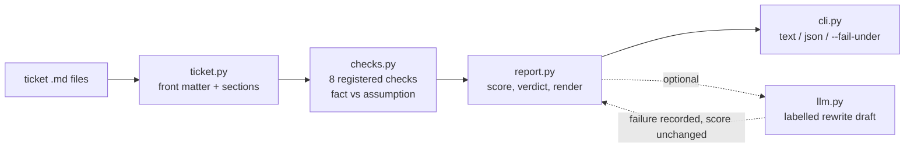

# ticket-readiness-lab

An advisory reviewer for engineering tickets. Point it at markdown tickets and it reports missing acceptance criteria, ambiguous wording, likely edge cases, and undeclared dependencies, always separating **what it observed** from **what it is guessing**, and always leaving the ready/not-ready call to a person.

> All tickets in `data/tickets/` are fictional (`SYN-*`). This is a portfolio project built from public knowledge; it is not an employer project and encodes no employer process or rules.

## Who it is for and what problem it solves

**Audience:** engineering managers, tech leads, and product owners who run backlog refinement; also anyone building "AI reviews your work" tooling and wondering how to keep it honest.

**Problem:** half of refinement time goes to tickets that were never ready: no testable criteria, "should be fast", "like the other feature", a dependency hiding in the notes. Reviewers catch these inconsistently. A tool can catch the mechanical ones every time, but only if it is clear about what it actually knows versus what it is inferring, otherwise people either over-trust it or ignore it.

**MVP scope (complete):**
- Markdown ticket format with light front matter (`id`, `title`, `depends_on`)
- Eight checks: empty ticket, actor/outcome, acceptance criteria (presence and testability), ambiguous terms, scope, domain-aware edge-case prompts, dependencies (undeclared ticket refs, cross-team mentions), recorded assumptions
- Every finding tagged `fact` (quoted evidence) or `assumption` (to confirm)
- Readiness score with an explicitly advisory verdict; `--fail-under` for CI gates that a human can override
- Text and JSON output; batch review of many files with per-file error handling
- Optional model-generated rewrite that is labelled, never changes the score, and degrades gracefully when unavailable

## Stack and why

- **Python 3.10+, standard library only.** The checks are regex and structure inspection; a dependency-free core means the demo runs anywhere and is trivially auditable, which matters for a tool whose whole pitch is transparency.
- **pytest + GitHub Actions** (3.10 and 3.12).
- **`anthropic` SDK as an optional extra** for the rewrite feature. The rules engine is the product; the model is a convenience.

## Quick start (no credentials needed)

```bash
pip install -e ".[dev]"
ticket-readiness review data/tickets/*.md
ticket-readiness review data/tickets/vague-export.md --json
ticket-readiness review data/tickets/*.md --fail-under 50 ; echo "exit $?"
make test
```

### Optional: model-drafted rewrite

```bash
cp .env.example .env     # git-ignored
pip install -e ".[llm]"
export TICKET_READINESS_PROVIDER=anthropic ANTHROPIC_API_KEY=... TICKET_READINESS_MODEL=<model id>
ticket-readiness review data/tickets/vague-export.md
```

The model is given the ticket plus the findings and asked to draft a clearer version that writes `OPEN QUESTION:` wherever a decision is needed rather than deciding. Output appears under "Suggested rewrite (anthropic; model-generated, review before use)". If the call fails, the report is still produced and `rewrite_provider` records why.

## Walkthrough (actual output)

```
$ ticket-readiness review data/tickets/vague-export.md
== SYN-101: Add export button
   readiness 30/100 - not ready (advisory)
   Observed (facts):
     [high] acceptance-criteria: No acceptance-criteria section.
            suggest:  Add 'Acceptance criteria' with testable Given/When/Then bullets.
     [medium] ambiguity: Ambiguous term 'fast'.
            evidence: ...oard that exports everything. Should be fast and work like the import feature....
            suggest:  state a measurable target (e.g. p95 under 2s for 10k rows)
     [medium] ambiguity: Ambiguous term 'like the'.
            evidence: ...rts everything. Should be fast and work like the import feature....
            suggest:  name the exact behaviours to copy; 'like X' hides decisions
     [medium] user-and-outcome: No actor or outcome is stated (no 'As a ... I want ... so that ...').
     ...
   To confirm (assumptions):
     [medium] edge-cases: Possible unhandled edge case: very large result sets (timeouts, memory, pagination or async job?)
     [medium] edge-cases: Possible unhandled edge case: zero rows to export (empty-state UX)
     [medium] edge-cases: Possible unhandled edge case: permissions: can a user export data they can only partially see?
     [low] scope: No out-of-scope section; scope creep risk.
   Advisory output. Facts are observed in the ticket text; assumptions are the reviewer's guesses to confirm or reject. A human decides whether the ticket is ready.
```

```
$ ticket-readiness review data/tickets/*.md | grep -E "^==|readiness"
== SYN-105: Dark mode for settings page
   readiness 94/100 - looks ready (advisory)
== SYN-104: Fix the thing
   readiness 40/100 - not ready (advisory)
== SYN-102: Password reset via email
   readiness 86/100 - looks ready (advisory)
== SYN-103: Rate limit the public search API
   readiness 34/100 - not ready (advisory)
== SYN-101: Add export button
   readiness 30/100 - not ready (advisory)
```

`SYN-102` (a well-written ticket) earns only assumption-level prompts, e.g. "concurrent reset requests for one account", plus a low-severity fact noting it already records an assumption that someone must own.

## Architecture



Checks register themselves with a decorator, so adding one is a function in `checks.py` plus a test.

## Design tradeoffs

- **Facts vs assumptions as a first-class field.** The alternative (one undifferentiated list) is simpler but is exactly how review tools lose trust: a guessed edge case stated with the same confidence as a missing section. Assumptions also cost half as much in the score.
- **Any high-severity fact caps the score at 40.** Early scoring let an empty ticket score 75 because every other check skips an empty body. A cap encodes the judgement that one missing fundamental outweighs many small wins.
- **Regex heuristics instead of a model classifier.** They are explainable, fast, and produce quoted evidence. The cost is recall: a vague ticket written without any trigger words passes. The optional rewrite is where a model adds value, as a drafting aid rather than a judge.
- **One finding per ambiguous term** keeps reports readable at the expense of a complete list.
- **`--fail-under` exists but the output says "advisory" everywhere.** Teams can gate CI on it, but the wording is designed to stop the number becoming a policy.

## Limitations

- English-only heuristics; the actor/outcome check expects user-story phrasing and will flag perfectly good tickets written another way.
- Edge-case hints are keyword-triggered and generic; they will suggest "large result sets" for any ticket mentioning "report".
- The parser handles a minimal front-matter subset (`key: value`, `key: [a, b]`), not full YAML.
- No integration with issue trackers; input is files.
- The real-model rewrite path was tested against a fake client, not a live API, in this repository's verification run.

## Verification

Run on Python 3.12.3, 2026-10-27:

```
$ python -m pytest --cov=ticket_readiness --cov-report=term-missing
31 passed in 0.27s
TOTAL  335 stmts  9 miss  97% coverage
```

Coverage: cli 100%, ticket 100%, report 98%, checks 97%, llm 87% (uncovered lines are the real SDK construction path). Tests include parser error paths, each check against the sample tickets, word-boundary behaviour (`breakfast` must not trigger `fast`), score capping, CLI exit codes, a fake model client, and a failing model client.

## What is simulated

Nothing in the default path involves a model; the `rules` provider is deterministic. The `anthropic` provider's output is labelled "model-generated, review before use". Nothing here has been used in production or evaluated against real backlogs.

## License

MIT
